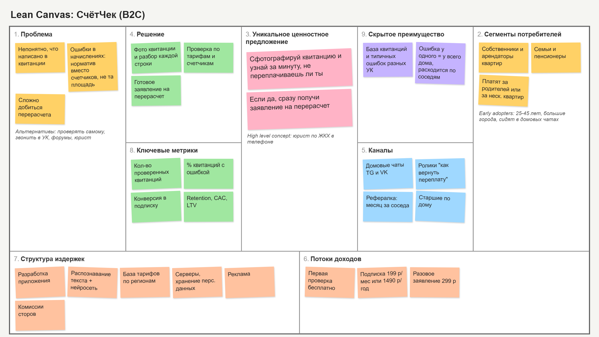

# СчётЧек

Проект по курсу "Методы управления разработкой ПО", VK Education.

## ДЗ 1. Elevator Pitch и Lean Canvas

Бизнес-модель: B2C

### Elevator Pitch

Почти все платят за ЖКХ, но мало кто понимает, что написано в квитанции. Там много строк, и в них часто бывают ошибки: считают по нормативу, хотя стоят счетчики, указана не та площадь или не то число жильцов, начисляют за то, чего не было. Проверить это самому сложно, а писать заявление на перерасчет никто не хочет, потому что непонятно как.

Мы делаем приложение СчётЧек. Человек фотографирует квитанцию, приложение распознает строки, сравнивает с тарифами в его регионе, с показаниями счетчиков и с прошлыми месяцами. Если что-то не сходится, приложение показывает, где ошибка, и делает готовое заявление на перерасчет, которое можно сразу отправить в УК.

Банковские приложения и Госуслуги дают только оплатить квитанцию. Мы помогаем разобраться в ней и вернуть деньги, если начислили лишнее. Первая проверка бесплатная, дальше подписка.

### Lean Canvas

**1. Проблема**
- В квитанции сложно разобраться, непонятно, правильно ли посчитали
- Бывают ошибки в начислениях: норматив вместо счетчиков, неправильная площадь, лишние строки
- Перерасчет добиться сложно, люди не знают, куда и как писать

Существующие альтернативы: проверять самому, звонить в УК, спрашивать на форумах или у юриста.

**2. Сегменты потребителей**
- Собственники и арендаторы квартир в многоквартирных домах
- Семьи и пенсионеры, для которых коммуналка заметная часть расходов
- Те, кто платит за родителей или за несколько квартир

Ранние последователи: люди 25-45 лет в больших городах, которые заметили, что квитанция выросла, и сидят в домовых чатах.

**3. Уникальное ценностное предложение**

Сфотографируй квитанцию и за минуту узнай, не переплачиваешь ли ты. Если переплачиваешь, получи готовое заявление на перерасчет.

High Level Concept: юрист по ЖКХ в телефоне.

**4. Решение**
- Распознавание квитанции по фото и объяснение каждой строки простыми словами
- Проверка начислений по тарифам региона, счетчикам и прошлым месяцам
- Готовое заявление на перерасчет и напоминание, когда УК должна ответить

**5. Каналы**
- Домовые чаты в Telegram и VK
- Ролики и посты про то, как вернуть переплату за ЖКХ
- Реферальная программа: месяц подписки за приглашенного соседа
- Советы домов и старшие по подъезду

**6. Потоки доходов**
- Бесплатная первая проверка
- Подписка 199 руб./мес. или 1490 руб./год: проверка каждой квитанции, заявления, история, до 3 квартир
- Разовое заявление без подписки за 299 руб.

**7. Структура издержек**
- Разработка и поддержка приложения
- Распознавание текста и запросы к нейросети
- Сбор базы тарифов по регионам
- Серверы и хранение персональных данных
- Реклама
- Комиссии магазинов приложений и платежных систем

**8. Ключевые метрики**
- Сколько квитанций проверили за месяц
- В каком проценте квитанций нашли ошибку
- Конверсия из бесплатной проверки в подписку
- Сколько заявлений отправили и сколько перерасчетов одобрили
- Retention, CAC, LTV

**9. Скрытое преимущество**
- База реальных квитанций и типичных ошибок разных УК, которая растет с каждым пользователем
- Если нашли ошибку у одного жильца, скорее всего она есть у всего дома, поэтому приложение легко расходится по соседям

## ДЗ 2. Гипотезы, CAC и LTV

### Ключевые гипотезы

**Гипотеза 1 (ценность, главная).** Люди действительно хотят проверять свои квитанции и готовы платить за это 199 руб. в месяц, если им показать, что в квитанции есть ошибка.

Почему главная: если людям это не нужно или они не готовы платить, то нет смысла делать распознавание, базу тарифов и все остальное.

**Гипотеза 2 (осуществимость).** Хотя бы в 10% квитанций есть ошибки, которые можно найти автоматически, сравнив начисления с тарифами региона, показаниями счетчиков и прошлыми месяцами.

Если ошибок почти нет или их можно найти только вручную, приложению нечего будет показывать пользователю.

### Как проверить главную гипотезу без разработки

Делаем ручной MVP (консьерж) и фейковую кнопку оплаты.

- **H:** Мы считаем, что жители многоквартирных домов пришлют фото квитанции на бесплатную проверку, а часть из них захочет оформить подписку.
- **A:** Делаем простой лендинг на Tilda: "Пришли фото квитанции, проверим бесплатно и скажем, есть ли переплата". Кидаем ссылку в 10-15 домовых чатов в Telegram и VK и запускаем таргет в VK на 3000 руб. Квитанции проверяем сами вручную по тарифам региона. Результат отправляем человеку, а в конце предлагаем подписку за 199 руб./мес. с кнопкой "Оформить". Кнопка ведет на страницу "Мы скоро запустимся, оставьте почту".
- **D:** Смотрим, сколько людей зашло на лендинг, сколько прислали квитанцию, у скольких нашли ошибку и сколько нажали "Оформить".
- **I:** Гипотеза подтверждается, если за 2 недели придет хотя бы 50 квитанций и хотя бы 10% из тех, кто получил результат, нажмут "Оформить". Если квитанций мало или почти никто не нажимает кнопку, значит людям это не так нужно и надо менять ценность или модель (например, брать процент с возвращенных денег вместо подписки).

Заодно этот тест проверяет и вторую гипотезу: проверяя квитанции вручную, мы увидим, как часто в них реально бывают ошибки.

### Откуда придут пользователи (CAC)

Основные каналы:
1. Таргетированная реклама в VK на жителей больших городов 25-45 лет.
2. Домовые чаты в Telegram и VK, посты и ролики "как я вернул переплату за ЖКХ".
3. Реферальная программа: бесплатный месяц подписки за приглашенного соседа.

**Расчет для таргета в VK:**
- Цена клика: 20 руб.
- Из перешедших 25% регистрируются и делают бесплатную проверку: 20 / 0,25 = 80 руб. за регистрацию
- Из тех, кто сделал проверку, 10% оформляют подписку: 80 / 0,10 = 800 руб.
- CAC через таргет = 800 руб.

**Домовые чаты и рефералка** почти бесплатные. Платим только бесплатным месяцем за приглашенного (себестоимость месяца около 50 руб.) и временем на посты. Примерно 150 руб. за платящего пользователя.

Если половина пользователей придет из таргета и половина из чатов и рефералки, средний CAC = (800 + 150) / 2 = **475 руб.**

### На чем зарабатываем (LTV)

Основной доход это подписка 199 руб./мес. Еще есть разовые заявления по 299 руб. для тех, кто не хочет подписку, но в расчет их не берем.

Расходы на одного подписчика в месяц:
- комиссия магазина приложений или платежки: около 30 руб.
- распознавание текста и нейросеть: около 10 руб.
- серверы: около 5 руб.
- поддержка: около 5 руб.

Итого около 50 руб., значит с одного подписчика остается 199 - 50 = 149 руб. в месяц.

Считаем, что в среднем человек пользуется подпиской 10 месяцев (квитанция приходит каждый месяц, и ее удобно проверять регулярно).

LTV = 149 * 10 = **1490 руб.**

**LTV / CAC** = 1490 / 475 = **3,1**. Это больше 3, значит юнит-экономика сходится. Но только если половина пользователей приходит из бесплатных каналов. Если брать людей только через таргет, то 1490 / 800 = 1,9, а это мало. Поэтому сначала делаем упор на домовые чаты и рефералку.

## ДЗ 3. User Stories

### Основной путь пользователя

Человек получил квитанцию, сфотографировал ее, увидел, что в ней не так, отправил заявление на перерасчет и через месяц проверил новую квитанцию.

### User Stories

| № | User Story |
|---|---|
| US-1 | Как житель, я хочу сфотографировать квитанцию, чтобы не вводить данные вручную |
| US-2 | Как житель, я хочу увидеть каждую строку квитанции с понятным объяснением, чтобы понимать, за что я плачу |
| US-3 | Как житель, я хочу, чтобы приложение само нашло возможные ошибки в начислениях, чтобы не разбираться в тарифах самому |
| US-4 | Как житель, я хочу указать площадь квартиры и число жильцов, чтобы проверка учитывала мои данные |
| US-5 | Как житель, я хочу ввести показания счетчиков, чтобы приложение сравнило их с тем, что начислили |
| US-6 | Как житель, я хочу получить готовое заявление на перерасчет, чтобы не писать его самому |
| US-7 | Как житель, я хочу скачать заявление в PDF или отправить его по почте в УК, чтобы быстро его подать |
| US-8 | Как житель, я хочу зарегистрироваться по номеру телефона, чтобы мои квитанции сохранялись |
| US-9 | Как житель, я хочу оформить подписку, чтобы проверять каждую квитанцию без ограничений |
| US-10 | Как житель, я хочу видеть историю квитанций по месяцам, чтобы замечать, когда сумма выросла |
| US-11 | Как житель, я хочу получить напоминание, когда УК должна ответить на заявление, чтобы не забыть про него |
| US-12 | Как житель, я хочу добавить несколько квартир, чтобы проверять квитанции родителей |
| US-13 | Как житель, я хочу пригласить соседа и получить бесплатный месяц, чтобы платить меньше |
| US-14 | Как житель, я хочу видеть, сколько денег мне уже удалось вернуть, чтобы понимать пользу от приложения |
| US-15 | Как житель, я хочу видеть, есть ли такая же ошибка у соседей по дому, чтобы подать коллективную жалобу |

### Приоритизация (MoSCoW)

**Must have** (без этого продукт не работает):
- US-1 Фото квитанции
- US-3 Поиск ошибок
- US-4 Данные квартиры
- US-5 Показания счетчиков
- US-6 Готовое заявление
- US-8 Регистрация
- US-9 Подписка

**Should have** (очень нужно, но можно запуститься и без этого):
- US-2 Объяснение строк
- US-7 PDF и отправка в УК
- US-10 История квитанций

**Could have** (приятно, если успеем):
- US-11 Напоминание об ответе УК
- US-12 Несколько квартир
- US-13 Рефералка

**Won't have** (в этой версии не делаем):
- US-14 Счетчик возвращенных денег
- US-15 Ошибки у соседей и коллективная жалоба

### MVP и MLP

**MVP ("скелет")**: минимальный путь от фото до заявления. US-1, US-3, US-4, US-5, US-6, US-8, US-9. Человек фотографирует квитанцию, вводит площадь, жильцов и счетчики, видит ошибки и получает заявление. Подписка нужна, чтобы сразу проверить, будут ли платить. В MVP входят все истории из Must have.

**MLP (фичи для вау-эффекта)**: то, за что приложение будут любить и советовать. US-2 (объяснение каждой строки простым языком), US-7 (отправка в УК в один клик), US-10 (график, как менялась квитанция), US-11 (напоминания), US-14 (сколько уже вернули), US-15 (ошибки у всего дома).

### Детализация двух главных историй

#### US-1. Фото квитанции

Как житель, я хочу сфотографировать квитанцию, чтобы не вводить данные вручную.

Функциональные требования:
1. Пользователь может сделать фото квитанции камерой или выбрать фото из галереи.
2. Поддерживаются форматы JPG, PNG, HEIC и PDF размером до 10 МБ.
3. Система распознает с квитанции: период, адрес, лицевой счет, название УК, список услуг, объем, тариф и сумму по каждой строке, итоговую сумму.
4. После распознавания система показывает пользователю распознанные данные, и он может исправить любое поле вручную.
5. Если фото нечитаемое (размыто, обрезано, темное), система сообщает об этом и просит сделать фото заново.
6. Система проверяет, что сумма строк совпадает с итоговой суммой, и если нет, подсвечивает расхождение.

Нефункциональные требования:
1. Распознавание одной квитанции занимает не больше 15 секунд.
2. Точность распознавания сумм не ниже 95% на четких фото.
3. Фото передаются только по HTTPS, хранятся в зашифрованном виде на серверах в РФ (152-ФЗ).
4. Фото удаляется с сервера через 30 дней, распознанные данные остаются в аккаунте.
5. Работает на iOS 15+ и Android 9+.

#### US-3. Поиск ошибок в начислениях

Как житель, я хочу, чтобы приложение само нашло возможные ошибки в начислениях, чтобы не разбираться в тарифах самому.

Функциональные требования:
1. Система сравнивает тариф в каждой строке с действующим тарифом для региона и УК из базы тарифов.
2. Система пересчитывает сумму по каждой услуге по формуле "объем x тариф" и сравнивает с суммой в квитанции.
3. Если стоят счетчики, а начисление по нормативу, система помечает это как возможную ошибку.
4. Система сравнивает площадь и число жильцов в квитанции с данными, которые ввел пользователь.
5. Система находит одинаковые повторяющиеся строки (двойное начисление).
6. Для каждой найденной ошибки система показывает: в какой строке ошибка, почему это ошибка, сколько примерно переплачено в рублях.
7. Если ошибок нет, система пишет, что квитанция выглядит правильной.

Нефункциональные требования:
1. Проверка одной квитанции после распознавания занимает не больше 5 секунд.
2. База тарифов обновляется не реже одного раза в месяц и при каждой официальной индексации.
3. Доля ложных срабатываний (система нашла ошибку, а ее нет) не больше 10%.
4. На запуске поддерживаются минимум 5 крупных регионов (Москва, Московская область, Санкт-Петербург, Екатеринбург, Новосибирск).
5. Сервис доступен 99% времени в месяц.
