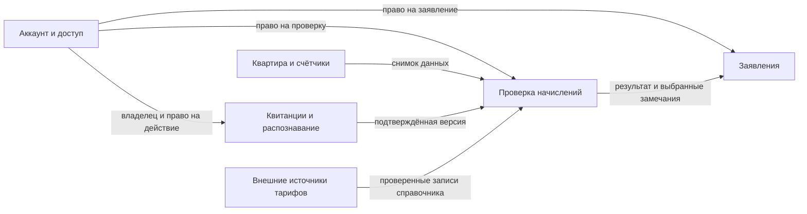
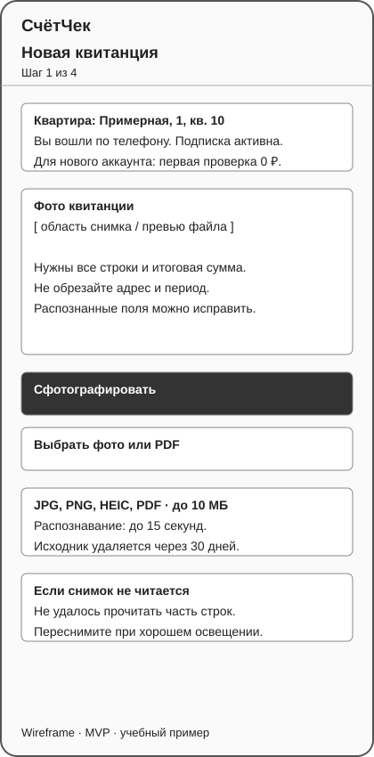
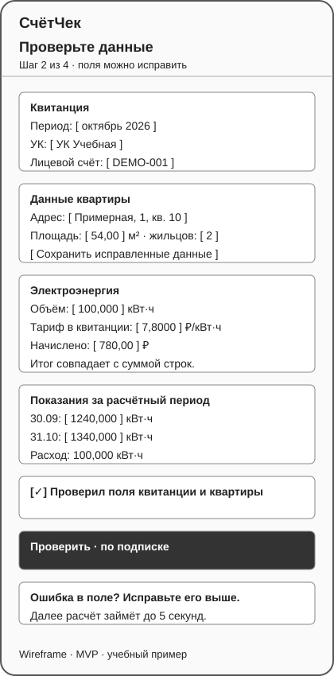
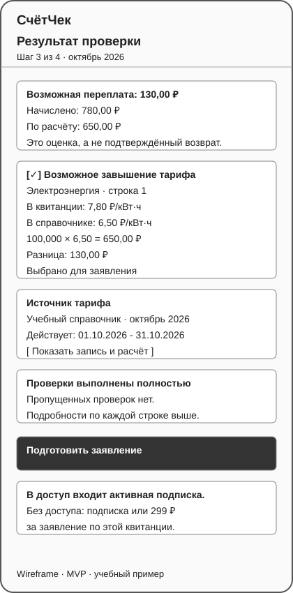
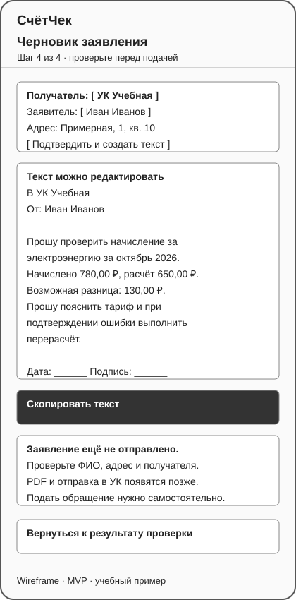

# ДЗ4. Домены, сценарий MVP, экраны и API

Продолжение проекта «СчётЧек» из [ДЗ1-3](../../README.md). Приложение помогает проверить квитанцию ЖКХ и подготовить заявление на перерасчёт.

## 1. Что входит в эту версию

Берём MVP из ДЗ3: US-1, US-3, US-4, US-5, US-6, US-8 и US-9. Пользователь входит по телефону, добавляет данные квартиры, фотографирует квитанцию, подтверждает распознанные поля, получает результат проверки и текст заявления.

Первая успешная проверка бесплатная. Следующие доступны по подписке. Заявление доступно по подписке или после разовой оплаты 299 руб., как в бизнес-модели ДЗ1. Для основного сценария ниже пользователь уже оформил подписку за 199 руб./мес. Вход и оплата являются условиями сценария, а не отдельными новыми фичами.

PDF, отправка в УК, история с графиками, напоминания и несколько квартир остаются в следующих версиях. В MVP готовое заявление можно прочитать, отредактировать и скопировать как текст. Приложение не отправляет его автоматически и не обещает, что УК одобрит перерасчёт.

Суммы и тарифы ниже придуманы для примера. Это не действующие тарифы и не результат проверки реальной квитанции.

## 2. Доменные зоны (DDD)

Разделение нужно, чтобы у каждой части были свои данные, правила и понятные названия. На старте это пять модулей одного приложения. Отдельные микросервисы для MVP не нужны.

### 2.1. Аккаунт и доступ

Отвечает за вход по телефону и право на платные функции. Здесь находятся пользователь, подписка, бесплатная проверка и разовая покупка заявления.

| Термин | Значение |
| --- | --- |
| Пользователь | Владелец аккаунта, вошедший по номеру телефона |
| Подписка | Оплаченный доступ к проверкам и заявлениям до определённой даты |
| Бесплатная проверка | Одна успешная проверка на аккаунт без подписки |
| Разовая покупка | Право создать заявление по одной конкретной квитанции |
| Право доступа | Ответ на вопрос, может ли пользователь сейчас выполнить действие |

Правила: неудачная проверка не расходует бесплатную попытку. Повтор одного запроса не расходует её ещё раз. Право на проверку и право на заявление проверяются отдельно. Два одновременных запроса не могут оба потратить одну бесплатную попытку. Данные чужого аккаунта недоступны.

### 2.2. Квартира и счётчики

Хранит данные, с которыми пользователь предлагает сравнивать квитанцию. Не распознаёт фото и не решает, есть ли переплата.

| Термин | Значение |
| --- | --- |
| Квартира | Объект проверки с адресом, площадью и числом жильцов |
| Жильцы | Число людей, указанное пользователем для расчётов |
| Счётчик | Прибор учёта конкретной услуги |
| Показание | Значение счётчика на указанную дату |
| Расход | Разница текущего и предыдущего показаний за период |

Правила: площадь положительная, число жильцов целое и неотрицательное. Единицы счётчика и услуги должны совпадать. Если текущее показание меньше предыдущего, проверка просит уточнить данные. Замена и сброс счётчика в MVP автоматически не рассчитываются.

### 2.3. Квитанции и распознавание

Принимает фото или PDF, распознаёт поля и даёт исправить их. Эта зона отвечает за то, что прочитано из документа, а не за правильность начислений.

| Термин | Значение |
| --- | --- |
| Исходник | Загруженный файл квитанции |
| Черновик квитанции | Результат распознавания, который ещё не подтвердил пользователь |
| Строка квитанции | Услуга, объём, тариф и начисленная сумма |
| Подтверждённая версия | Неизменяемый снимок полей после проверки пользователем |
| Расхождение итога | Сумма строк не совпала с итогом на квитанции |

Правила: поддерживаются JPG, PNG, HEIC и PDF до 10 МБ, как в ДЗ3. Нечитаемый исходник нужно загрузить заново. Перед расчётом пользователь исправляет сомнительные поля и расхождение итога. Каждое подтверждение создаёт новую версию. Исходник удаляется через 30 дней по требованиям ДЗ3; подтверждённые данные сохраняются.

### 2.4. Проверка начислений

Сравнивает подтверждённую квитанцию с данными квартиры, показаниями и справочником тарифов. Это основная доменная зона: она отвечает за пользу продукта.

| Термин | Значение |
| --- | --- |
| Проверка | Расчёт по одной версии квитанции и снимку данных квартиры |
| Правило проверки | Условие поиска конкретного расхождения, например неверного тарифа |
| Запись тарифа | Тариф для территории, поставщика, услуги и периода с указанием источника |
| Возможная ошибка | Расхождение, которое стоит проверить или оспорить в УК |
| Возможная переплата | Оценка разницы между начисленной и рассчитанной суммой |
| Пропущенная проверка | Правило, которое нельзя применить из-за отсутствующих данных |

Правила: тариф выбирается на период квитанции, а не на сегодняшнюю дату. При отсутствии тарифа нельзя подставлять средний или писать, что ошибок нет. Проверка сохраняет версии правил, тарифа и входных данных. Одна строка может дать несколько замечаний, но её переплата учитывается в общем итоге только один раз.

Для примера с электричеством ниже: расход 100 кВт·ч, тариф квитанции 7,80 руб., тариф справочника 6,50 руб. Начислено 780 руб., рассчитано 650 руб., возможная переплата 130 руб. Эта разница ещё не означает, что деньги возвращены.

### 2.5. Заявления

По выбранным замечаниям готовит редактируемый текст обращения. Не меняет результат проверки и не списывает деньги самостоятельно.

| Термин | Значение |
| --- | --- |
| Заявление | Обращение в УК с просьбой проверить начисления и сделать перерасчёт |
| Основание | Выбранная пользователем возможная ошибка из завершённой проверки |
| Заявитель | Человек, от имени которого составлен текст |
| Получатель | УК, название которой подтвердил пользователь |
| Черновик заявления | Сохранённый текст, который пользователь может проверить и исправить |

Правила: нельзя составить заявление по чужой проверке или подставить сумму со стороны клиента. В текст попадают только выбранные замечания, период, адрес и расчёт из проверки. Перед копированием пользователь проверяет свои данные и получателя. В MVP у заявления нет статуса «отправлено» или «перерасчёт одобрен».

### Как зоны связаны



Модули передают друг другу идентификаторы и снимки данных. Распознавание не создаёт замечания о переплате. Проверка не меняет подписку напрямую, а обращается к модулю доступа. Заявление использует сохранённый результат, поэтому изменение тарифа в справочнике не переписывает уже созданный текст.

## 3. Критический путь MVP (BDD)

**Путь:** фото квитанции → подтверждение данных → возможная ошибка → текст заявления. Связан с US-1, US-3, US-4, US-5 и US-6. US-8 и US-9 обеспечивают вход и доступ.

```gherkin
Функция: Подготовка заявления по возможной ошибке в квитанции

  Сценарий: Подписчик нашёл завышенный тариф и получил текст заявления
    Дано пользователь вошёл по телефону и имеет действующую подписку
    И ему принадлежит квартира площадью 54,00 м² с двумя жильцами
    И есть показания электросчётчика 1240,000 и 1340,000 кВт·ч за октябрь 2026
    И в учебном справочнике для этой услуги, поставщика и периода тариф 6,5000 руб./кВт·ч
    Когда пользователь загружает читаемое фото квитанции за октябрь 2026
    Тогда не позднее 15 секунд он видит распознанные поля
    Когда пользователь подтверждает адрес, период и строку электричества
    И подтверждает объём 100,000 кВт·ч, тариф 7,8000 руб. и начисление 780,00 руб.
    И нажимает «Проверить»
    Тогда не позднее 5 секунд он видит завершённую проверку
    И видит замечание «Возможное завышение тарифа»
    И видит начисление 780,00 руб., расчёт 650,00 руб. и разницу 130,00 руб.
    И видит источник и период действия использованного тарифа
    Когда пользователь выбирает замечание и нажимает «Подготовить заявление»
    И подтверждает ФИО, адрес и название УК
    Тогда получает редактируемый текст заявления с этими данными и расчётом
    И может скопировать его
    Но приложение не отправляет заявление в УК автоматически
```

Условия, которые тоже должны соблюдаться на этом пути:

| Ситуация | Что происходит |
| --- | --- |
| Фото нечитаемое | Просим переснять; расчёт не запускается, бесплатная попытка не расходуется |
| Распознавание ошиблось | Пользователь исправляет поля и подтверждает новую версию |
| Не совпал итог или не хватает обязательных полей | Подсвечиваем поля; проверка недоступна до исправления |
| Тарифа нет | Отмечаем тарифную проверку как пропущенную; не пишем «квитанция правильная» |
| Проверены все применимые правила, расхождений нет | Пишем «По доступным данным расхождений не найдено», заявление не предлагаем |
| Бесплатная проверка уже использована, подписки нет | Предлагаем подписку; расчёт не запускаем |
| Для заявления нет подписки или разовой покупки | Предлагаем подписку либо разовую оплату; текст пока не создаём |
| Сеть оборвалась после нажатия | Повторяем запрос с тем же ключом; не создаём дубликат и не расходуем доступ повторно |

## 4. Wireframes

Это схемы структуры мобильных экранов, а не финальный дизайн. Авторизация и оплата остаются отдельными стандартными шагами. Здесь показаны четыре экрана основного пути подписчика.

| 1. Квитанция | 2. Подтверждение данных |
| --- | --- |
|  |  |
| Выбор фото или файла, доступ и подсказка при плохом снимке. US-1, US-8, US-9. | Исправление OCR, площадь, жильцы и показания перед расчётом. US-1, US-4, US-5. |

| 3. Результат | 4. Заявление |
| --- | --- |
|  |  |
| Сумма, расчёт, источник тарифа и выбор замечания. US-3. | Подтверждение получателя и заявителя, правка и копирование текста. US-6. |

На экране 2 кнопка «Проверить» активна только после подтверждения обязательных полей. На экране 3 при пропущенных проверках виден отдельный блок с причиной. На экране 4 кнопки отправки в УК нет.

## 5. JSON-контракты API

Полная спецификация двух ручек: [openapi.json](api/openapi.json). Примеры запросов и ответов находятся в [api/examples](api/examples). Это проект контрактов для разработки, сами ручки в этом репозитории пока не реализованы.

### Общие договорённости

- HTTPS, JSON в UTF-8, версия API в пути `/api/v1`.
- `Authorization: Bearer <token>`; пользователь определяется сервером, `user_id` в запросе не передаётся.
- Суммы и тарифы передаются десятичными строками, а не float. Деньги округляются до копеек по правилу half-up. Объёмы имеют три знака, тарифы четыре. Валюта MVP: RUB.
- Даты имеют вид `YYYY-MM-DD`, период квитанции `YYYY-MM`, время ответа в UTC.
- Для POST нужен `Idempotency-Key`. Повтор того же тела с тем же ключом возвращает тот же статус и результат. Ключ привязан к пользователю и ручке, хранится 24 часа. Другое тело с тем же ключом даёт `409`.
- Ошибка имеет единый формат `error.code`, `error.message`, `error.fields`, `error.request_id`. В ответе нет токенов или исходника квитанции.

Загрузка файла и OCR происходят до первой ручки. Модуль квитанций сохраняет исправленный пользователем снимок и отдаёт `receipt_id` и `receipt_version`. Модуль квартиры аналогично отдаёт `apartment_id` и `apartment_version`. Передаваемые ссылки на версии позволяют проверить именно те данные, которые пользователь видел на экране 2. Контракты загрузки, входа, оплаты и редактирования здесь не расписываются, чтобы оставить две главные ручки.

### 5.1. `POST /api/v1/checks`

Назначение: проверить подтверждённую квитанцию по снимку квартиры и показаниям. Экран 2 → экран 3.

Запрос: [check-request.json](api/examples/check-request.json).

```json
{
  "receipt_id": "rcpt_001",
  "receipt_version": 2,
  "apartment_id": "apt_001",
  "apartment_version": 3
}
```

Для примера снимок квитанции содержит период `2026-10`, электричество `100.000 kWh`, тариф `7.8000` и начисление `780.00`. Снимок квартиры содержит площадь `54.00`, двух жильцов, показания `1240.000` и `1340.000` от 30 сентября и 31 октября. Полные снимки приведены в [input-snapshots.json](api/examples/input-snapshots.json); это подготовленные данные, а не третья ручка.

Сервер проверяет владельца, подтверждение квитанции, актуальность версий и доступ. Затем берёт тариф на период квитанции, выполняет правила и сохраняет результат. Показания используются только для услуг со счётчиком; отсутствующие данные отражаются в пропущенных проверках. Расчёт синхронный, целевое время из ДЗ3 не больше 5 секунд.

Успех: `201 Created`, [check-response.json](api/examples/check-response.json). Ответ содержит `check_id`, ссылки на входные версии, `findings`, список `skipped_rules`, возможную переплату и сведения об использованном праве доступа. В каждом замечании есть строка квитанции, причина, начисленная и рассчитанная суммы, правило и запись тарифа с источником.

`coverage=complete` означает, что проверены все применимые к квитанции правила, `partial` означает пропуски. `result` принимает `findings`, `no_discrepancies` или `inconclusive`. Если замечаний нет, но есть пропуски, возвращается `inconclusive`, а не `no_discrepancies`. Часть правил может дать замечания даже при пропущенной проверке тарифа.

### 5.2. `POST /api/v1/statements`

Назначение: подготовить текст по выбранным замечаниям. Экран 3 → экран 4.

Запрос: [statement-request.json](api/examples/statement-request.json).

```json
{
  "check_id": "chk_001",
  "finding_ids": ["fnd_001"],
  "applicant": {"full_name": "Иван Иванов"},
  "recipient": {"organization_name": "УК Учебная"}
}
```

ФИО и УК в примере вымышлены. Сервер проверяет принадлежность завершённой проверки, связь всех `finding_ids` с ней и право на заявление. Сумма, период, адрес и лицевой счёт берутся из сохранённого снимка. Клиент не передаёт свою сумму возврата. Для разовой покупки право относится к квитанции из этой проверки и не открывает другие квитанции.

Успех: `201 Created`, [statement-response.json](api/examples/statement-response.json). Ответ содержит `statement_id`, `status=draft`, `check_id`, выбранные замечания и `text`. Текст можно редактировать на клиенте и копировать. Сохранение пользовательской правки отдельной ручкой в это ДЗ не входит.

В заявлении формулируется просьба проверить начисление и выполнить перерасчёт при подтверждении ошибки. Оно не утверждает, что УК уже признала долг. Если тарифная проверка пропущена, основание о завышенном тарифе создать нельзя.

### Ошибки и повторы

| HTTP | `error.code` | Когда |
| --- | --- | --- |
| 400 | `INVALID_JSON` / `IDEMPOTENCY_KEY_REQUIRED` | Невалидный JSON или не передан ключ повтора |
| 401 | `UNAUTHORIZED` | Нет действительного токена |
| 403 | `CHECK_ACCESS_REQUIRED` / `STATEMENT_ACCESS_REQUIRED` | Нужна подписка или доступ к заявлению |
| 404 | `RESOURCE_NOT_FOUND` | Объект не найден или принадлежит другому пользователю |
| 409 | `VERSION_CONFLICT` | Клиент подтвердил старую версию квитанции или квартиры |
| 409 | `IDEMPOTENCY_CONFLICT` | Один ключ использован с разными телами запросов |
| 422 | `VALIDATION_ERROR` | Неподтверждённая квитанция, неверные поля или замечания не из выбранной проверки |
| 503 | `TEMPORARILY_UNAVAILABLE` | Проверку или создание текста сейчас нельзя завершить; результат и расход доступа не фиксируются |

Отсутствующий тариф сам по себе не даёт 500 или 503: это частичная проверка с `skipped_rules`. Поля ошибок, конфликт версий и частичный результат показаны отдельными JSON-примерами.

## 6. Как проверить на защите

1. На учебной квитанции показать 780 руб. начисления, 650 руб. расчёта и 130 руб. возможной переплаты.
2. Перейти по четырём экранам и показать, откуда берутся данные для каждого из двух запросов.
3. Показать вариант без тарифа: нет утверждения, что квитанция правильная, есть причина пропуска.
4. Повторить запрос с тем же ключом: результат тот же, вторая проверка и второй расход доступа не появились.
5. Показать, что заявление использует выбранное замечание и сохранённый расчёт, но не отправляется в УК.
